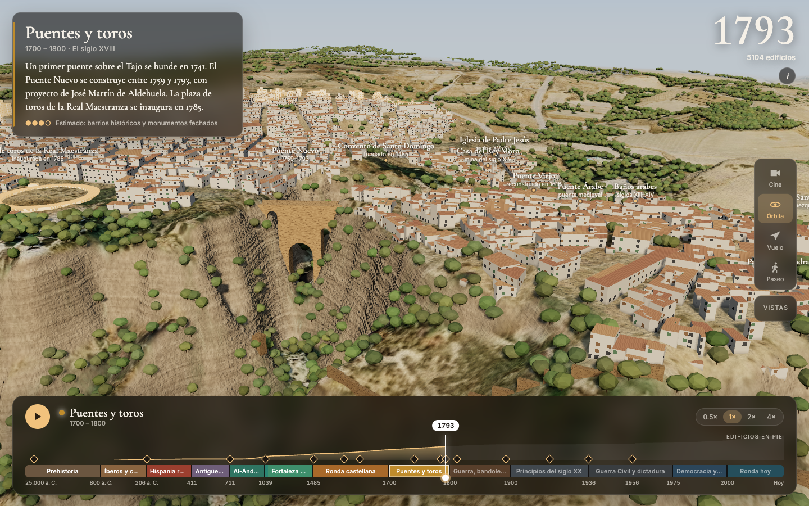

# Ronda a través del tiempo

Línea de tiempo interactiva en 3D (Three.js) de Ronda (Málaga), de la prehistoria a hoy.



## Ejecutar

```bash
npm install
npm run dev      # http://localhost:5173
npm run build    # sitio estático en dist/ (Vercel, GitHub Pages…)
```

## Datos (`scripts/`, necesita `uv`)

| Script | Resultado |
|---|---|
| `fetch_raster.py` | MDT05 del IGN y ortofotos (1956, 1973–86, 2004, 2024) de 4 × 4 km |
| `fetch_hires.py` | ortofoto 2024 a 0,5 m del centro (2 × 2 km) |
| `process_buildings.py` | edificios del Catastro con año estimado → `public/data/buildings.json` |
| `export_terrain.py` | `public/data/dem.bin` |
| `make_landscape.py` | paisaje histórico (ciudad sustituida por campo), árboles detectados, texturas WebP |
| `grid_view.py` | imagen de depuración para dibujar `zones.json` |

Catastro no tiene años anteriores a 1900 y para casas antiguas guarda el año de la última
reforma. Dentro de los barrios históricos de `scripts/zones.json` (dibujados sobre la foto de
1956) el año es una estimación. Fuera de ellos se usa el año del Catastro.

## Código

- `src/timeline.ts`: escala del tiempo, épocas, hitos y textos
- `src/terrain.ts`: terreno, mezcla de fotos por año, roca en los tajos, relieve fino
- `src/buildings.ts`: todos los edificios en una malla; crecen en su año; ventanas y tejas
- `src/trees.ts`: ~60.000 árboles detectados en la ortofoto
- `src/landmarks.ts`: puentes, murallas, alcazaba, etiquetas
- `src/camera.ts`: modos Cine, Órbita, Vuelo y Paseo, y vistas
- `src/ui.ts`: barra de tiempo
- `tools/shot.mjs`: capturas con GPU real (Chrome headless + Playwright de otro proyecto)

## Rendimiento y controles de la escena

El terreno usa niveles de detalle por distancia; los árboles se dibujan por zonas y los
edificios futuros se omiten. Las sombras se conservan mientras no cambie la escena. Una
vista en órbita sin movimiento deja de dibujar fotogramas.

Los controles **Luz**, **Detalle** y **Nombres** permiten cambiar la iluminación, ajustar
la calidad y ocultar etiquetas. **Auto** reduce la calidad si el tiempo de fotograma es alto.
El botón **Vistas** también funciona en pantallas táctiles.

En móviles y dispositivos con poca memoria, **Auto** empieza con una densidad de hasta 1,5,
sin oclusión ambiental ni multimuestreo y con sombras de 1024 px. Las fotografías visibles se
mejoran a 2048 px sobre vistas previas de 1024 px. Se conservan como máximo tres fotografías
grandes: su presupuesto de 64 MiB incluye mipmaps y la imagen que se está cargando. Cambiar
de lugar o de época libera las imágenes grandes que ya no hacen falta. Este presupuesto cubre
las mejoras de las fotografías del terreno, no toda la memoria de la escena.

Los archivos móviles se regeneran con `uv run scripts/export_mobile_textures.py` después
de cambiar las fotografías o la máscara urbana. Si el tiempo por fotograma es alto, **Auto**
reduce la densidad a 1 y conserva las fotografías nítidas dentro de su presupuesto. El modo
**Ligero** y la recuperación de WebGL liberan las imágenes grandes. El botón **Recargar**
permite reintentar si el navegador no recupera el contexto.

El selector **Idioma** está junto al año. Se puede enlazar directamente a un idioma con
`?lang=en` o `?lang=es`, también junto a una fecha: `?lang=en#year=1793`. Un parámetro válido
tiene prioridad sobre la preferencia guardada. Un valor no válido usa la preferencia guardada
o español. Cambiar el selector actualiza el enlace y guarda la preferencia si el navegador lo permite.

`npm run check:mobile -- http://localhost:5319` comprueba la recuperación de WebGL, el presupuesto
gráfico móvil, los cambios de tamaño, el idioma y el arranque con almacenamiento bloqueado.
Usa Chrome con pantalla táctil y densidad de píxeles emuladas; no sustituye una prueba en un teléfono real.

`npm run check:mobile-textures -- http://localhost:5319` comprueba la resolución de las fotos
en vistas cercanas, el límite de memoria y la liberación de imágenes al recorrer lugares y épocas.
Incluye recuperación durante una descarga y reducción automática de resolución sin perder detalle.
Se puede repetir con WebKit mediante `PW_BROWSER=webkit npm run check:mobile-textures -- http://localhost:5319`
después de instalar ese navegador con `npx playwright-core install webkit`.

Las mediciones y las instrucciones de comprobación están en [docs/performance](docs/performance/README.md).
